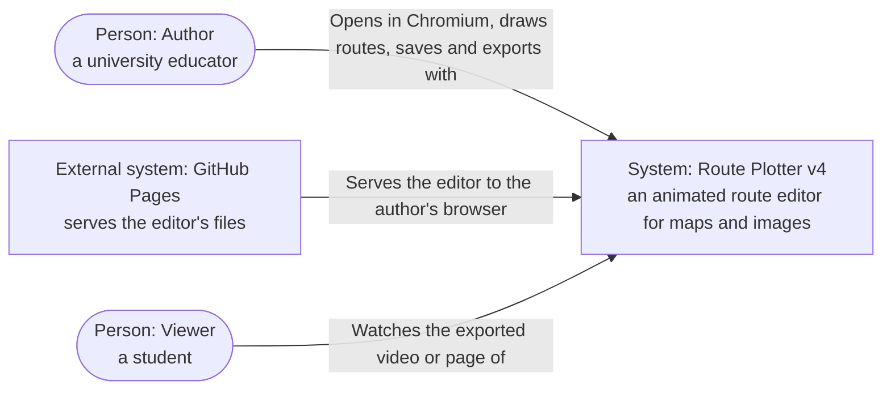
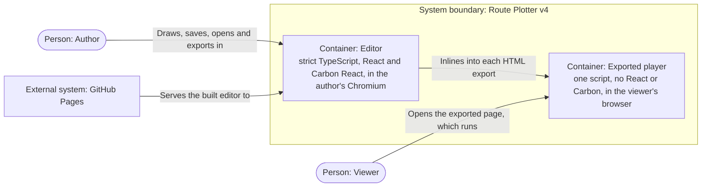

# Architecture — Route Plotter v4

Updated: 2026-11-19

<!-- pm-next architecture record, specification 3.26 — keep this line -->

<!-- Route Plotter v4's architecture record (PM-Skills 5.0.1, specification 3.26), written by STACK-04 from the v4
     architecture plan (reviews/v4-architecture-plan-2026-11-18.md, §8 and §14), provisional under the owner's
     overnight grant G3. Frozen v3's own architecture file is v3/ARCHITECTURE.md, moved there by the same item.
     The rules file routes code changes here. A change that adds, removes or renames a container or an external
     system, moves the boundary, or changes how two of them talk, or how the code is layered, updates this file and
     its Updated line in the same change. Directories belong in structure.md. -->

v4 is a static web app, built from this repository's root; nothing runs on a server of its own. Every frame is a pure
function of (timelineMs, projectState, seed), evaluated by one composer that the editor's preview, the video export and
the exported player share.

## System context

Who uses Route Plotter v4, and the one outside system it needs.

### Text alternative

- An author, a university educator, opens Route Plotter v4 in Chromium, draws routes on a map or image, saves the
  project as a file and exports a video or a web page.
- GitHub Pages, an external system, serves the editor's built files from this repository's `docs/`, written only by
  the publishing step.
- A viewer, a student, watches what the author exported: a video file, or a web page that plays the scene.

## Containers

Two containers run: the editor and the exported player. Inside them the code is layered, and `npm run boundaries`
enforces the layers (`.dependency-cruiser.cjs`); each rule has a planted violation in `tests/architecture/fixtures/`
that `npm run test:architecture` shows failing on every v4 change.

- `src/core`: the project model and its schema helper, geometry, the lead's timing and the clock. It reaches only
  itself.
- `src/adapters`: the renderer's kit (`src/adapters/render`), the ZIP and asset boundary, storage, the video encoder
  and the HTML export builder. They reach the core and each other.
- `src/features/<id>/`: one folder per feature. Its `model/` is pure and reaches the core and itself; its `draw/`
  reaches the core, the renderer's kit and its own model; its `editor/` reaches the shared control kit
  (`src/editor/kit`), `src/ui`, its own model, React and Carbon React. No feature reaches another or a catalogue; only
  `src/features/catalogue.ts` (definitions and drawing, safe for the player) and `catalogue.editor.ts` (panels) name
  several. The core and the adapters never reach a feature.
- `src/player`: the playback runtime and the composer (`compose.ts`). It reaches the core, the renderer's kit, itself,
  `catalogue.ts` and the features' `model/` and `draw/` parts; never another adapter, an editor part, jszip,
  mediabunny, React, React DOM or Carbon, directly or through another file. A closure test checks the built bundle too.
- `src/exported`: the exported player's entry. It reaches what the player may, and itself.
- `src/editor`: the React and Carbon app, its store and commands, and the control kit; `src/ui`: the theme and shared
  controls.
- No package enters the core, the adapters, the player or exported code until a decision lists it; no import forms a
  cycle; every import resolves. A new shared abstraction answers the abstraction plan's §16 in its pull request.

`npm run measures` prints the measures M1 to M11 the plan's §10 sets, and CI shows them in every v4 run's summary.

### Text alternative

Inside Route Plotter v4's boundary are two containers:

- the editor, a web page built with strict TypeScript, React and Carbon React, which runs in the author's Chromium.
  The author draws routes in it, saves and opens projects as files, keeps an autosave in the browser's own storage, and
  exports a video file or a web page. GitHub Pages, an external system, serves its built files.
- the exported player, one self-contained script with no React or Carbon inside, which the editor inlines into each
  web page it exports. It runs in the viewer's browser when the viewer opens that page, and draws the scene with the
  same composer as the editor.
